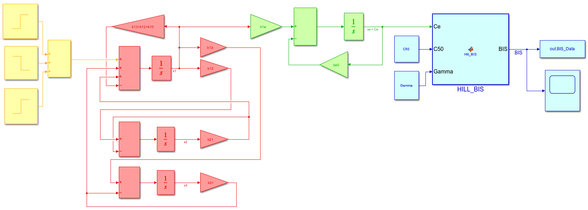
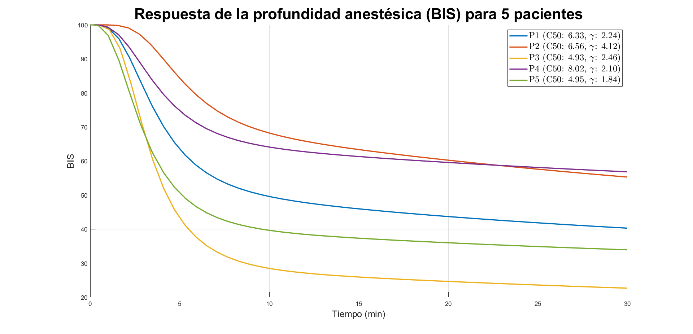
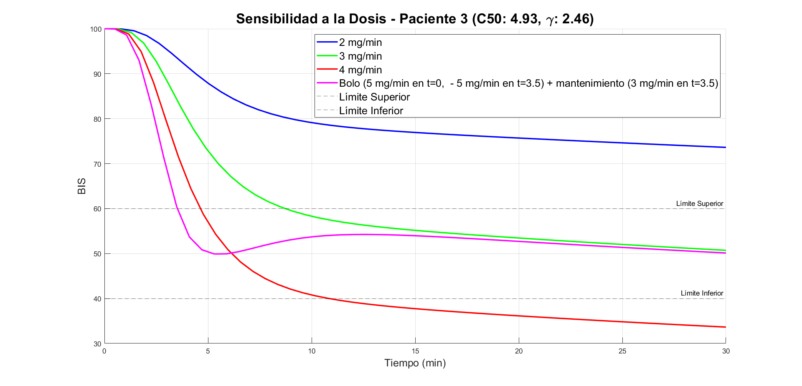

# Modelo compartimental PK-PD de la anestesia con propofol

Simulación en **MATLAB y Simulink** de cómo responde cada paciente a una infusión de propofol. El modelo une la **farmacocinética** (cómo se reparte y se elimina el fármaco en el cuerpo, con tres compartimentos y los parámetros de Schnider), la llegada del fármaco al **lugar de efecto** (el cerebro) y la **farmacodinámica**, que traduce la concentración en el cerebro al índice biespectral (**BIS**) con la ecuación de Hill.

*Three-compartment PK-PD model of propofol anaesthesia in MATLAB/Simulink (Schnider parameters, effect site and Hill equation for the BIS), simulated for several patient profiles and dosing strategies.*

Lo hemos hecho en la asignatura **Modelado de Sistemas Biomédicos** del Grado en Ingeniería de la Salud (mención en Ingeniería Biomédica, Universidad de Málaga), en diciembre de 2025.



## El modelo

**Farmacocinética (3 compartimentos).** $x_1$ es la cantidad de propofol en la sangre (compartimento central), $x_2$ y $x_3$ en los tejidos periféricos, y $u(t)$ la infusión en mg/min:

$$\dot{x}_1 = u(t) + k_{21}x_2 + k_{31}x_3 - (k_{10} + k_{12} + k_{13})\,x_1$$
$$\dot{x}_2 = k_{12}x_1 - k_{21}x_2 \qquad \dot{x}_3 = k_{13}x_1 - k_{31}x_3$$

Las constantes $k_{ij}$ se calculan para cada paciente a partir de su edad, peso, altura y sexo con las ecuaciones de Schnider (volúmenes $V_1, V_2, V_3$ y aclaramientos $Cl_1, Cl_2, Cl_3$).

**Lugar de efecto.** $\dot{x}_e = k_{1e}x_1 - k_{e0}x_e$, con $k_{1e} = k_{e0} = 0.456$ min⁻¹.

**Farmacodinámica (ecuación de Hill).** $C_{50}$ es la concentración que produce la mitad del efecto máximo y $\gamma$ la sensibilidad del paciente:

$$BIS(t) = BIS_0 + (BIS_{max} - BIS_0)\,\frac{C_e^{\gamma}(t)}{C_{50}^{\gamma} + C_e^{\gamma}(t)}$$

El BIS va de 100 (despierto) a 0, y el rango adecuado para la cirugía está entre 40 y 60.

## Qué hemos simulado

1. **Siete pacientes** con distinta edad, altura, peso, sexo, $C_{50}$ y $\gamma$ (cinco estándar y dos casos extremos), todos con la misma dosis constante.
2. **Casos extremos** (P6 y P7): el paciente más grande (P7) baja el BIS más despacio por su mayor volumen de distribución.
3. **Un solo paciente con distintas dosis** (P3): infusiones constantes de 2, 3 y 4 mg/min y un bolo seguido de dosis de mantenimiento.

| Resultado con la misma dosis | Distintas dosis para el paciente P3 |
|---|---|
|  |  |

## Conclusiones

- El modelo predice la profundidad anestésica de cada paciente y su comportamiento tiene sentido físico.
- Con la misma dosis los pacientes responden de forma muy distinta, así que una dosis fija es peligrosa (riesgo de despertar durante la operación o de sobredosis) y hace falta ajustarla a las características de cada paciente.
- Para P3, el BIS entra en el rango de 40 a 60 con una infusión de 3 mg/min y con el esquema de bolo más mantenimiento.

## Estructura del repositorio

```
Trabajo.slx                    modelo de Simulink (PK, lugar de efecto y bloque de Hill)
Trabajo.mlx                    script en vivo de MATLAB que calcula los parámetros y lanza las simulaciones
Trabajo.m                      el mismo código en texto plano, para leerlo desde GitHub
presentacion_modelo_pkpd.pdf   presentación del trabajo
figuras/                       figuras de la presentación
```

## Cómo ejecutarlo

1. Abrir MATLAB (lo hemos usado con la versión R2023b, con Simulink).
2. Poner como carpeta de trabajo la del repositorio.
3. Abrir `Trabajo.mlx` y pulsar **Run**. El script calcula los parámetros de los siete pacientes, llama al modelo `Trabajo.slx` con `sim()` y dibuja las gráficas.

## Autores

Antonio Sánchez Doña e Iván de la Torre Segato.
